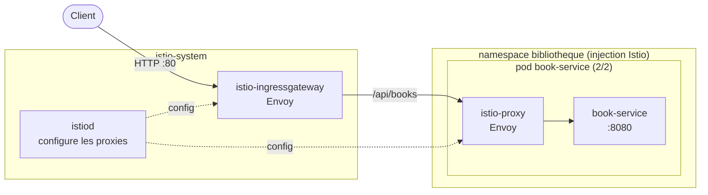

# Bibliothèque : microservices sur Docker, Kubernetes et Istio

Rémi Dalmas & Gonçalo DE SOUSA PIHNO  
LSI2APP

Projet 2026 : application de gestion d'une bibliothèque, construite étape par étape en suivant le sujet.

| Étape du sujet | État |
|---|---|
| **1. Commencer par un seul service en local (10/20)** | fait |
| **2. Ajouter une gateway en local, via un service mesh (12/20)** | cette version |
| 3. Ajouter un deuxième service et les relier (14/20), option gRPC | à venir |
| 4. Ajouter une base de données (16/20) | à venir |
| 5. Sécuriser le cluster (18/20) | à venir |
| 6. Déployer dans le cloud (20/20) | à venir |

## Étape 1 : un seul service en local

Le sujet demande, pour cette étape :

| Demandé | Réalisé | Où |
|---|---|---|
| Coder une mini application | `book-service` : catalogue de livres en Java 21 / Spring Boot 4.1, API REST (CRUD + recherche), base H2 en mémoire | `book-service/` |
| Créer une image Docker (Dockerfile) | Dockerfile multi-étapes, image Alpine, utilisateur non-root | `book-service/Dockerfile` |
| Publier l'image sur le Docker Hub | Script de publication (connexion par access token) + CI GitHub Actions | `scripts/push-dockerhub.sh`, `.github/workflows/ci.yml` |
| Créer un déploiement Kubernetes | Deployment avec sondes de santé, limites CPU/mémoire, mise à jour sans coupure, conteneur non-root en lecture seule | `k8s/book-service.yaml` |
| Créer un service Kubernetes | Service qui répartit les requêtes entre les pods (NodePort à l'étape 1, ClusterIP derrière la gateway depuis l'étape 2) | `k8s/book-service.yaml` |

Chaque réponse contient l'en-tête `X-Served-By` avec le nom du pod qui a répondu.

**Pourquoi un seul réplica ?** La base H2 est en mémoire, à l'intérieur du pod. Avec deux pods,
chacun aurait sa propre base : un livre créé via le premier pod serait introuvable via le second.
C'est la limite de la base en mémoire ; l'étape « base de données » (PostgreSQL partagé) permettra
de passer à plusieurs réplicas.

## Étape 2 : une gateway via le service mesh Istio



| Ajouté | Rôle | Où |
|---|---|---|
| Installation d'Istio | istiod (plan de contrôle) + istio-ingressgateway (point d'entrée du cluster) | `k8s/istio/istio-install.yaml`, `scripts/install-istio.sh` |
| Injection automatique du sidecar | Chaque pod du namespace reçoit un proxy Envoy : il passe de 1/1 à 2/2 conteneurs | `k8s/namespace.yaml` (label `istio-injection: enabled`) |
| Gateway | Ouvre le port 80 de la gateway Istio | `k8s/istio/gateway.yaml` |
| VirtualService | Routage : `/api/books` → Service `book-service`, avec délai maximal (10 s) et nouvelles tentatives sur erreurs réseau. Le reste (dont `/actuator`) n'est pas exposé | `k8s/istio/gateway.yaml` |
| DestinationRule | Répartition vers le pod le moins chargé, limite de connexions, éjection d'un pod défaillant (circuit breaker) | `k8s/istio/traffic.yaml` |
| Service en ClusterIP | book-service n'est plus exposé directement (fini le NodePort) : la gateway est le seul point d'entrée | `k8s/book-service.yaml` |

Rien n'a changé dans le code Java : toutes ces fonctionnalités sont apportées par le proxy Envoy.

---

## Prérequis

| Outil | Pour | Installation |
|---|---|---|
| Java 21 | lancer le service sans Docker (facultatif) | https://adoptium.net |
| Docker Desktop (ou Docker Engine) | construire et lancer l'image | https://www.docker.com/get-started |
| minikube | cluster Kubernetes local | https://minikube.sigs.k8s.io/docs/start/ |
| kubectl | piloter Kubernetes | https://kubernetes.io/fr/docs/tasks/tools/ |
| istioctl | installer Istio (téléchargé automatiquement par `scripts/install-istio.sh` s'il manque) | https://istio.io/latest/docs/setup/getting-started/ |
| Un compte Docker Hub | publier l'image | https://hub.docker.com |

Sous Windows, lancez les scripts `.sh` depuis **Git Bash** ou **WSL**.

Créez votre fichier d'environnement et mettez-y **votre pseudo Docker Hub** :

```bash
cp .env.example .env
```

---

## 1. Lancer le service sur sa machine

```bash
cd book-service
./gradlew test                                              # 10 tests
./gradlew bootRun --args='--spring.profiles.active=dev'     # http://localhost:8080/api/books
```

Le profil `dev` active la console H2 : http://localhost:8080/h2-console (URL JDBC `jdbc:h2:mem:books`, utilisateur `sa`, sans mot de passe).
Au démarrage, une douzaine de livres de démonstration sont insérés.

Dans un autre terminal : `./scripts/test.sh`

## 2. Image Docker

```bash
./scripts/build-image.sh                       # docker build -t docker.io/<pseudo>/bibliotheque-book-service:1.0.0 book-service
docker run --rm -p 8080:8080 docker.io/<pseudo>/bibliotheque-book-service:1.0.0
./scripts/test.sh
```

Le Dockerfile compile le projet dans une première image (JDK + Gradle), puis ne copie que le jar
dans une image finale légère (JRE Alpine), qui tourne avec un utilisateur sans privilèges.

## 3. Publication sur le Docker Hub

```bash
./scripts/push-dockerhub.sh
```

Utilisez un **Personal Access Token** Docker Hub (Account settings > Personal access tokens) comme mot de passe.

## 4. Déploiement Kubernetes + Istio (minikube)

```bash
./scripts/cluster-minikube.sh      # minikube start (4 CPU, 8 Go : Istio en a besoin)
./scripts/install-istio.sh         # istioctl install -f k8s/istio/istio-install.yaml
./scripts/deploy.sh                # kubectl apply -k k8s/ avec votre image Docker Hub
```

Variante sans Docker Hub (image chargée directement dans minikube) :

```bash
LOAD=minikube ./scripts/build-image.sh && ./scripts/deploy.sh
```

Si la version de l'étape 1 est déjà déployée, il suffit d'installer Istio puis de relancer
`./scripts/deploy.sh` : le pod est recréé avec son sidecar et le Service repasse en ClusterIP.

Accès à l'application, **par la gateway Istio** :

```bash
# Le plus simple, sur n'importe quel cluster (laisser tourner dans un terminal) :
kubectl -n istio-system port-forward svc/istio-ingressgateway 8080:80
./scripts/test.sh                  # http://localhost:8080/api/books

# Ou avec minikube tunnel (laisser tourner) : la gateway obtient une adresse externe
minikube tunnel
kubectl -n istio-system get svc istio-ingressgateway    # colonne EXTERNAL-IP (127.0.0.1 sous macOS/Windows)
BASE_URL=http://<EXTERNAL-IP> ./scripts/test.sh
```

Commandes utiles pour la démo :

```bash
kubectl get all -n bibliotheque                       # Deployment, pod 2/2 (app + istio-proxy), Service
kubectl get gateway,virtualservice,destinationrule -n bibliotheque
istioctl analyze -n bibliotheque                      # vérifie la configuration Istio
curl -i http://localhost:8080/api/books | grep -i server          # server: istio-envoy
kubectl logs -n bibliotheque -l app=book-service -c istio-proxy --tail=5   # logs d'accès Envoy
kubectl describe deployment book-service -n bibliotheque
kubectl logs -n bibliotheque -l app=book-service --tail=20
kubectl delete pod -n bibliotheque -l app=book-service --wait=false   # Kubernetes recrée le pod
kubectl scale deployment book-service -n bibliotheque --replicas=3
#   -> les lectures sont réparties entre 3 pods (voir X-Served-By), mais un livre créé n'existe
#      que dans la base en mémoire du pod qui a reçu la requête : d'où le besoin d'une vraie base.
```

**Visualiser le mesh (facultatif)** : Kiali dessine le graphe des appels en temps réel.

```bash
kubectl apply -f istio-1.31.4/samples/addons/prometheus.yaml -f istio-1.31.4/samples/addons/kiali.yaml
istioctl dashboard kiali      # puis générez du trafic avec ./scripts/test.sh
```

(Le dossier `istio-1.31.4/` est créé par `scripts/install-istio.sh` quand il télécharge istioctl ;
sinon, prenez les fichiers dans votre propre téléchargement d'Istio.)

Nettoyage : `./scripts/nettoyage.sh` (ajoutez `ISTIO=1` pour désinstaller aussi Istio)

---

## API REST : `/api/books`

| Méthode | URL | Description | Codes |
|---|---|---|---|
| GET | `/api/books?q=camus` | Liste (recherche titre/auteur facultative) | 200 |
| GET | `/api/books/{id}` | Détail d'un livre | 200, 404 |
| POST | `/api/books` | Création (champs validés) | 201, 400, 409 (ISBN déjà utilisé) |
| PUT | `/api/books/{id}` | Modification | 200, 400, 404, 409 |
| DELETE | `/api/books/{id}` | Suppression | 204, 404 |
| GET | `/actuator/health` | Santé (sondes Kubernetes) ; non exposé par la gateway | 200 |

Exemple :

```bash
curl -X POST http://localhost:8080/api/books -H 'Content-Type: application/json' \
     -d '{"isbn":"978-2-07-036002-4","title":"Le Rouge et le Noir","author":"Stendhal","totalCopies":2}'
```

Les erreurs suivent le format standard **Problem Details** (RFC 9457) :

```json
{ "status": 400, "title": "Données invalides", "errors": { "title": "Le titre est obligatoire" } }
```

---

## Structure du projet

```text
.
├── book-service/                       Microservice catalogue (Spring Boot)
│   ├── src/main/java/fr/bibliotheque/book/
│   │   ├── domain/                     Entité Book, repository JPA, règles métier (BookService)
│   │   ├── web/                        Contrôleur REST, gestion des erreurs, en-tête X-Served-By
│   │   └── config/                     Données de démonstration
│   ├── src/test/                       Tests (service + API REST avec MockMvc)
│   └── Dockerfile
├── k8s/                                Manifests Kubernetes (kubectl apply -k k8s/)
│   ├── namespace.yaml                  Namespace avec injection Istio
│   ├── book-service.yaml               Deployment + Service
│   ├── istio/
│   │   ├── istio-install.yaml          Configuration d'installation d'Istio
│   │   ├── gateway.yaml                Gateway + VirtualService (routage)
│   │   └── traffic.yaml                DestinationRule (répartition, circuit breaker)
│   └── kustomization.yaml
├── scripts/                            cluster-minikube, install-istio, build-image, push-dockerhub, deploy, test, nettoyage
└── .github/workflows/ci.yml            Tests + image Docker à chaque push
```

## Intégration continue

À chaque push, GitHub Actions lance les tests et construit l'image. Sur `main`, si les secrets
`DOCKERHUB_USERNAME` et `DOCKERHUB_TOKEN` sont définis dans le dépôt (Settings > Secrets and
variables > Actions), l'image est aussi publiée sur le Docker Hub.

---

Testé avec : Java 21, Spring Boot 4.1.2, Docker 29, Kubernetes 1.34, Istio 1.31.4.